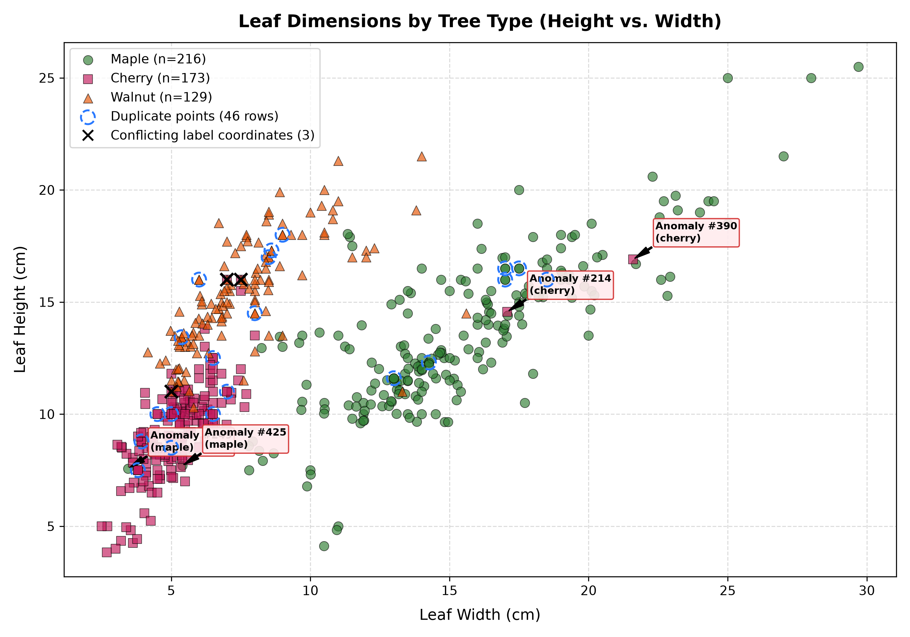
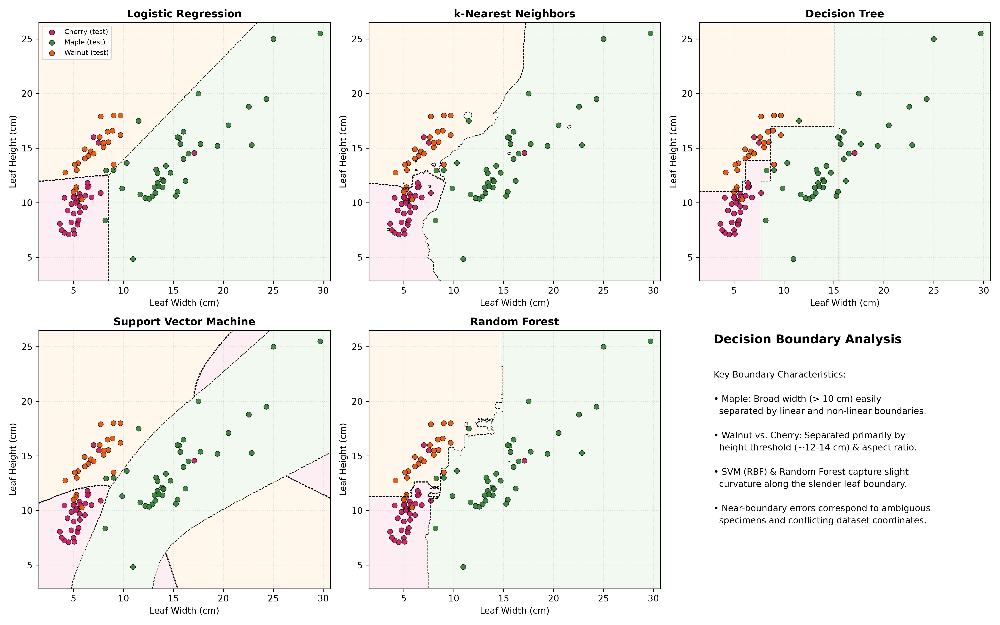

## 1. Problem & Leaf Morphology

:::: {.columns}
::: {.column width="55%"}
### Goal & Dataset Overview
- **Objective:** Determine how accurately tree species can be predicted using only two geometric measurements: **Leaf Height** and **Leaf Width**.
- **Dataset (`data/leaves.csv`):** 518 raw records across three tree species:
  - **Maple:** Broad palmate leaves ($W \approx 15.5\text{ cm}, H \approx 13.5\text{ cm}$)
  - **Cherry:** Compact ovate leaves ($W \approx 5.4\text{ cm}, H \approx 9.3\text{ cm}$)
  - **Walnut:** Slender leaflets ($W \approx 7.5\text{ cm}, H \approx 15.3\text{ cm}$)
- **Morphology:** Strong clustering along aspect ratio ($H/W$), but noticeable overlap along the Cherry–Walnut boundary.
:::

::: {.column width="45%"}
{width=100%}
:::
::::

## 2. Methodology & Leakage Prevention

### Ensuring Honest Generalization Numbers

- **Data Integrity Audit:**
  - EDA revealed **26 exact duplicate records** (46 total rows involved).
  - A naive random split would place identical rows across train and test sets, causing **data leakage** and inflated test metrics.
  - **Remediation:** Removed exact duplicates upfront $\rightarrow$ **492 clean unique samples**.

- **Rigorous Test Isolation:**
  - **Frozen 20% Stratified Held-Out Test Set:** 99 samples locked away before training.
  - **Training Split (80%):** 393 samples used exclusively for model tuning.
  - **Validation:** 5-fold Stratified Cross-Validation on the training set only.

- **Baseline Floor (ZeroR / Majority Class):**
  - Always predicts *Maple* $\rightarrow$ **CV Balanced Acc: 33.3%**, **CV Macro F1: 0.198**, **Test Acc: 42.4%**.

## 3. 5-Fold Cross-Validation Comparison

### Hyperparameter Tuning Across 5 Classical Classifiers (232 Trials)

| Classifier | Best Hyperparameters | CV Macro F1 | CV Balanced Acc | CV Accuracy |
|:---|:---|:---:|:---:|:---:|
| **k-Nearest Neighbors** | $k=7$, Euclidean, Distance Weights | **0.9556** | **0.9560** | **95.92%** |
| **Support Vector Machine** | RBF Kernel, $C=100.0, \gamma=0.1$ | **0.9407** | **0.9423** | **94.66%** |
| **Random Forest** | $n=50$, max_depth=8, min_split=5 | **0.9389** | **0.9396** | **94.40%** |
| **Decision Tree** | Gini, max_depth=5, min_split=10 | **0.9322** | **0.9349** | **93.63%** |
| **Logistic Regression** | L2 Penalty, $C=1.0$, Scaled | **0.9280** | **0.9294** | **93.39%** |
| *ZeroR Baseline* | Majority class (*Maple*) | *0.1980* | *0.3333* | *42.24%* |

- **Key Finding:** Non-linear classifiers (**k-NN** and **RBF SVM**) outperform linear Logistic Regression by capturing the curved boundary between slender Walnut and compact Cherry leaves.

## 4. Final Evaluation & Error Analysis

:::: {.columns}
::: {.column width="55%"}
### Frozen Held-Out Test Performance (k-NN)
- **Evaluated Exactly Once on 99 Unseen Samples:**
  - **Test Accuracy:** **90.91%** (90 / 99 correct)
  - **Test Macro F1:** **0.8983** | **Test Balanced Acc:** **0.8983**
  - **Maple:** Precision 95.2%, Recall 95.2%, **F1: 95.2%** (40/42)
  - **Cherry:** Precision 90.9%, Recall 90.9%, **F1: 90.9%** (30/33)
  - **Walnut:** Precision 83.3%, Recall 83.3%, **F1: 83.3%** (20/24)

### Error Breakdown (9 Misclassifications)
- Maple is virtually error-free (broad width easily separable).
- Remaining 9 errors are concentrated along the boundary where Walnut and Cherry overlap in height ($\approx 12\text{--}14\text{ cm}$).
:::

::: {.column width="45%"}
{width=100%}
:::
::::

## 5. Conclusion & Recommendations

### Summary of Findings
1. **Predictive Feasibility:** Leaf height and width are highly predictive of tree species, yielding an honest, leak-free **90.9% Test Accuracy** and **0.898 Macro F1**.
2. **Best Classifier:** Distance-weighted **k-Nearest Neighbors ($k=7$)** achieved the best generalization, closely followed by RBF SVM and Random Forest.
3. **Leakage Lesson:** Removing identical records was essential; without deduplication, test metrics would be artificially inflated and untrustworthy.

### Practical Engineering Recommendations
- **Feature Engineering:** Adding explicit **Aspect Ratio** ($H/W$) and **Area** ($H \times W$) could eliminate boundary confusion without increasing collection cost.
- **Label Cleaning:** Investigate the 3 coordinate pairs with conflicting labels in the source dataset to remove residual label noise.
